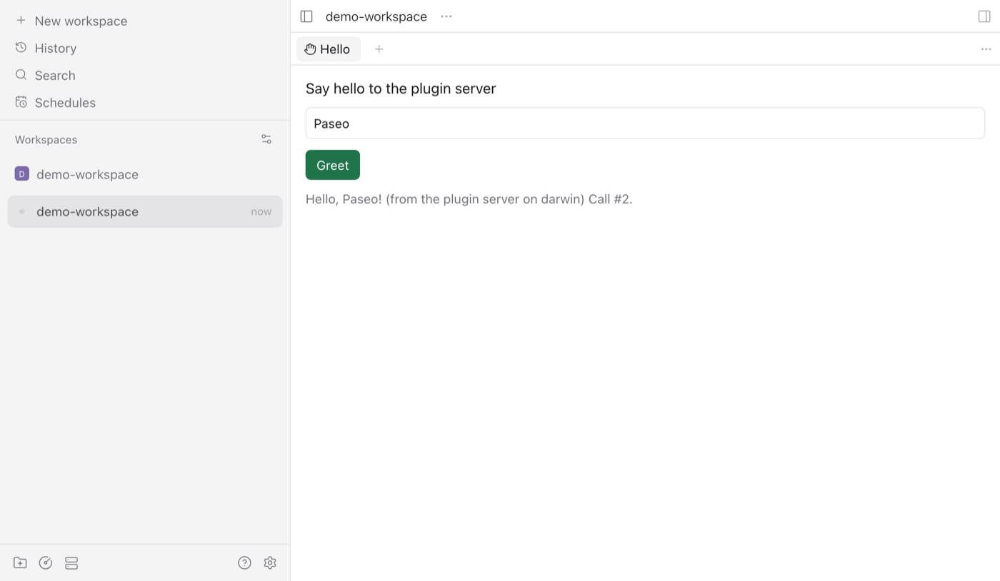

# paseo-plugin-devkit

  

**Test, verify and ship [Paseo](https://github.com/getpaseo/paseo) plugins without touching your real Paseo.**

`ppd` is a CLI, a set of vitest helpers and a Claude Code skill. One command gives you an isolated dev daemon, another checks your plugin against the host's undocumented runtime contract, others drive the web UI, an Android phone, releases and the registry.

## Why

Built while shipping a real plugin (a PDF and Office viewer). Each of these cost days, and each is now a check, a guard or one command:

- **Hand-built isolated daemons.** Testing a plugin means a temp home, a free port, plugins and the web UI on, relay off. One wrong flag and you restart or reconfigure your real daemon on port 6767. `ppd daemon up` does it safely in one line.
- **Host-contract surprises found late.** An icon name the app's Lucide build lacks makes the button silently vanish. `class` syntax in a dependency passes on web and crashes on phones (Hermes). A module the host does not provide throws only at load. `ppd check` finds these before install.
- **Registry submission gotchas.** Issues filed with `gh issue create` miss the `submission` label and are ignored. Git listings never get automatic update PRs. The validator fails on macOS temp paths. `ppd registry` handles all three.
- **Device testing friction.** `adb reverse`, which device, is the phone unlocked, and never pressing keys on someone's phone. `ppd android up` connects it and reports state, read-only.

## Quick start

Requires Node 22.18+ and, for the daemon commands, the Paseo CLI (the desktop app ships it). Not on npm yet.

**Try it on the bundled example plugin:**

```sh
git clone https://github.com/nkwib/paseo-plugin-devkit.git
cd paseo-plugin-devkit
npm ci                                   # installs and builds
npx ppd doctor                           # what is installed, what is missing
npx ppd check examples/hello-plugin      # host-contract checks with the installed Paseo app's compiler
npx ppd registry precheck examples/hello-plugin

# needs the Paseo CLI:
npx ppd daemon up --workspace /tmp/demo-workspace
npx ppd install examples/hello-plugin    # rerun after edits, or: npx ppd dev examples/hello-plugin
npx ppd web --command "Open Hello panel" --click Greet --shot out/hello.png
npx ppd daemon down
```

**Start a new plugin:**

```sh
npx ppd create ~/code/my-plugin                          # panel template: workspace panel + one RPC
npx ppd create ~/code/turn-cards --template agent-hook  # turn_ended hook + timeline card
cd ~/code/my-plugin && npm install
npm run check && npm test                                # ppd check, unit tests, host-contract suite
npx ppd daemon up --workspace /tmp/demo-workspace        # agent-hook: add --fake-agent
npx ppd dev                                              # install, reload on every change
```

`ppd create` runs `paseo plugin init` (SDK versions matching your Paseo) and adds what init leaves out: tsconfig `node` types, an `@types/node` ~22 pin, `.gitignore`, vitest, `npm run check`, a README. The result passes `ppd check` and installs as is. The devkit dependency defaults to `github:nkwib/paseo-plugin-devkit`; pass `--devkit file:/path/to/clone` for a local checkout.

**Add it to an existing plugin:**

```sh
npm install -D github:nkwib/paseo-plugin-devkit   # the repo is private for now: needs read access
npx ppd check                                     # plugin in cwd
```

`ppd check` compiles and evaluates with the installed Paseo app's own compiler and evaluator, and checks icon names against the app's Lucide set (both read from `Paseo.app/Contents/Resources/app.asar`). Order: `PASEO_SOURCE` (a [getpaseo/paseo](https://github.com/getpaseo/paseo) checkout with `npm ci` done, to test against unreleased Paseo), then the app (`--paseo-app`, `PASEO_APP`, the app behind `paseo` on PATH, `/Applications/Paseo.app`), then an esbuild replica. Replica results are labeled `APPROXIMATION`; `--approx` forces it.

## Demo

Real output from the commands above (temp path shortened):

```console
$ npx ppd check examples/hello-plugin
PASS  manifest         hello-plugin, requires paseo >=0.11.2
PASS  imports          client, server and shared boundaries hold
PASS  dependencies     no runtime packages
PASS  paseo-compile    compilePlugin of the Paseo 0.11.4 app (/Applications/Paseo.app) accepted the plugin
PASS  client-requires  client requires only host modules (@getpaseo/plugin, @getpaseo/plugin/client, react, react-native, react/jsx-runtime, zod)
PASS  server-requires  server requires only host modules and Node built-ins
PASS  server-eval      Paseo's evaluator ran the contribution in 0 ms; RPCs: hello.greet
PASS  client-eval      contributions: addWorkspacePanel, addCommandCenterItem
PASS  hermes-class     no class syntax in the client bundle
SKIP  hermes-parse     hermesc not found (install react-native as a devDependency, or set HERMESC)
SKIP  hermes-vm        Hermes VM not found (react-native ships it for macOS; or set HERMES)
PASS  lucide-icons     2 icon name(s) valid against 6354 Lucide icons of the Paseo 0.11.4 app (/Applications/Paseo.app)
PASS  bundle-size      client 5 KiB (2 KiB gzip), budget 2.0 MiB; server 2 KiB (1 KiB gzip), eval 0 ms, budget 32.0 MiB

11 passed, 0 warnings, 0 failed, 2 skipped

$ npx ppd daemon up --workspace /tmp/demo-workspace
dev daemon "default" up
  url:   http://127.0.0.1:7800
  home:  $TMPDIR/ppd-default-aiOmq4
  pid:   51399
  paseo: 0.11.4
workspace created for /tmp/demo-workspace

$ npx ppd install examples/hello-plugin    # rerun after edits, or: npx ppd dev examples/hello-plugin
installing examples/hello-plugin as hello-plugin into http://127.0.0.1:7800
hello-plugin: running (installed)
client: passes the app's registration rules
--- plugin logs
TIME                      STREAM    MESSAGE
2026-10-17T18:11:21.230Z  stdout    [paseo] Loading plugin
2026-10-17T18:11:21.477Z  stdout    [paseo] Plugin ready

$ npx ppd web --command "Open Hello panel" --click Greet --shot out/hello.png
opened workspace demo-workspace (wks_ef7618d24d59ccb1)
screenshot: out/hello.png
console errors: none
plugin evaluation errors: none

$ npx ppd daemon down
stopped dev daemon "default" (pid 51399)
removed $TMPDIR/ppd-default-aiOmq4
```

The screenshot `ppd web` took: the example's panel, served by the isolated daemon, after its RPC round trip.



## Commands

Every command has `ppd <command> --help`.

| Command | What it does |
| --- | --- |
| `ppd create <dir>` | New plugin that passes `ppd check` and installs as is. `--template panel` (default: workspace panel, Command Center item, one RPC) or `agent-hook` (`server.on("agent.turn_ended")` appends a timeline card; client renderer and a screen it opens). Wraps `paseo plugin init`, built-in base without it (`--no-init`). `--id`, `--name`, `--devkit`. |
| `ppd doctor` | Node, Paseo CLI and version, web UI build, check compiler (app or checkout), browser, Hermes, adb, Xcode, gh, disk, running dev daemons. |
| `ppd daemon up` | Detached daemon in a fresh home under `$TMPDIR` on a free port (7800-7899): plugins and web UI on; relay, MCP and speech off. `--workspace DIR`, `--port`, `--name`, `--caffeinate`, `--fake-agent` (installs the scripted provider below). |
| `ppd daemon down` / `status` | Stops the daemon and removes its home / shows it with installed plugins. |
| `ppd install [dir]` | Installs a plugin into the dev daemon, or reloads (same directory) or replaces an installed one, so rerun it after edits. Checks the client against the app's registration rules: an unknown icon or bad id makes the app drop the whole client with only a console warning, so `ppd install` reports `client-rejected` and exits 1. `--git` installs committed HEAD through the manifest `build`, like a registry install; a plugin in a repo subfolder is installed with `--path`. |
| `ppd dev [dir]` | Installs, then watches: every change reloads the plugin (`paseo plugin reload`), re-checks the client and prints the result; plugin log lines stream as they appear. |
| `ppd paseo -- <args>` | Any Paseo CLI call against the dev daemon, e.g. `plugin reload <id>`, `plugin logs <id>`. |
| `ppd web` | Web UI in Chrome via Playwright: opens the workspace, prints console errors and plugin clients the app failed to evaluate (exit 1 if any). `--shot`, `--viewport 390x844`, `--command "<Command Center item>"`, `--click "<aria label>"`, `--headed`. |
| `ppd android up\|down\|status` | `adb reverse` to the dev daemon for a phone running the Paseo app. Read-only device checks (lock, screen, foreground app). |
| `ppd check [dir]` | Host-contract checks, below. `--json`, `--paseo-app`, `--paseo-source`, `--approx`, `--max-client-kb`, `--max-server-kb`. |
| `ppd registry precheck` | OVERVIEW.md lint, media and icon paths, lockfile sync, `build` sanity, listing files committed. |
| `ppd registry submit` | Prints the prefilled registry form URL (a `tree/<ref>/<path>` URL for a plugin in a repo subfolder) and what to verify after. |
| `ppd registry update --registry <fork>` | Record-edit branch for a Git release in your registry fork, runs the validator, prints push and PR commands. `--yes` runs them. |
| `ppd release <patch\|minor\|major\|X.Y.Z>` | Checks the remote first (origin exists, tag not on origin, `git push --dry-run` passes), then bumps, writes the changelog section, commits, tags, pushes and creates the GitHub release. Rerun after a failed push resumes from the push. `--dry-run` prints the commands. |

### What `ppd check` verifies

| Check | How |
| --- | --- |
| Compile | Paseo's own `compilePlugin`, from the installed app or `PASEO_SOURCE`; an esbuild replica (labeled `APPROXIMATION`) only when neither is found. Compile errors carry file:line:col. |
| Client modules | Bundle requires only host-provided modules; no gesture handler, reanimated, safe-area or Lucide imports. |
| Server bundle | Requires only host modules and Node built-ins; evaluated in a child process with Paseo's evaluator and a 30 s timeout (Paseo's init timeout); registered RPCs listed; the returned cleanup is called and handles it leaves open (servers, timers) are warnings. A `process.exit` or a hang fails. |
| Client eval | Factory runs in a child process against stub host modules, with the app's registration rules: ids, contexts, callbacks, duplicates, icons, cleanup. Any violation fails, because the app then drops the whole client. |
| Hermes | No class syntax; `hermesc` parse and a smoke run in the Hermes VM when the binaries are found. |
| Icons | Every contribution icon exists in the app's Lucide set (read from the app bundle). |
| Size, deps, boundaries | Bundle sizes, runtime deps in `dependencies`, client/server import boundaries, `@types/node` range. |

### In your test suite

```ts
// test/host-contract.test.ts: one vitest test per check
import { fileURLToPath } from "node:url";
import { describeHostContract } from "paseo-plugin-devkit/vitest";

describeHostContract(fileURLToPath(new URL("..", import.meta.url)));
```

```ts
import { assertWithinRpcBudget } from "paseo-plugin-devkit/testing";
await assertWithinRpcBudget(() => handlers.get("doc.render")!(worstCaseInput)); // < 15 s, < 8 MiB
```

`paseo-plugin-devkit/web` exports the `PaseoWeb` Playwright page object for your own browser tests.

## Fake agent

Agent-facing plugins (hooks, timeline cards, injected MCP tools) need agent turns to test. `ppd daemon up --fake-agent` installs `fake-agent`, a credential-free provider plugin ([`assets/fake-agent`](assets/fake-agent)) that runs a scripted turn per prompt. It emits the timeline items real adapters produce, does the file effects for real in the agent's cwd, and calls tools on the MCP servers in its session config (what plugins inject in `before("agent.create")`), over HTTP or stdio. Paseo's own mock provider needs a development build and supports no MCP servers; this replaces it.

```sh
npx ppd daemon up --fake-agent
npx ppd paseo -- run --provider fake-agent --cwd /tmp/ws '{"steps":[{"write":{"path":"notes.md","content":"hi"}},{"say":"done"}]}'
```

A prompt is a script when it is JSON (`{"steps":[...]}` or a bare array) or contains a ` ```fake-agent ` fenced block. Otherwise the agent reads turn N from `<cwd>/.fake-agent.json` (`{"turns":[script, ...]}`, the last one repeats), else echoes the prompt as one assistant message. Steps, one key each, run in order:

| Step | Effect | Timeline item |
| --- | --- | --- |
| `{"say": "text"}` | | `assistant_message` |
| `{"think": "text"}` | | `reasoning` |
| `{"write": {"path", "content"}}` | writes the file (relative to cwd), creating directories | `tool_call` `Write`, `detail: {type: "write", filePath}` (absolute) |
| `{"edit": {"path", "old", "new"}}` | replaces the first `old` | `tool_call` `Edit`, `detail: {type: "edit", filePath, oldString, newString}`; `failed` if the file or string is missing |
| `{"bash": {"command", "output"?, "exitCode"?, "run"?}}` | with `run: true`, runs `sh -c` in cwd (60 s) and reports real output | `tool_call` `Bash`, `detail: {type: "shell", command, cwd, output, exitCode}`; `failed` if exit code is not 0 |
| `{"mcp": {"server", "tool", "arguments"?}}` | `initialize` then `tools/call` on that server (`"*"`: every server; none configured: nothing) | `tool_call` `mcp__<server>__<tool>`, `detail: {type: "unknown", input, output}`; `failed` on errors or an unknown server |
| `{"sleep": ms}` | waits (an interrupt cancels the turn) | |
| `{"fail": "message"}` | ends the turn as failed | `error` |

`"stepDelayMs": N` next to `steps` pauses before every step. A turn emits `user_message`, then the steps, then ends `completed`, `failed` (a `fail` step or an invalid script) or `canceled`, so `agent.turn_started` and `agent.turn_ended` fire as with a real provider. Like real adapters, a file a shell command writes is not attributed to it.

From tests (`paseo-plugin-devkit`):

```ts
import { agentTimeline, pluginRows, runFakeAgentTurn, sendFakeAgentTurn } from "paseo-plugin-devkit";

const { agentId, status } = runFakeAgentTurn([{ write: { path: "a.ts", content: "x" } }, { say: "done" }], { cwd: workspace });
sendFakeAgentTurn(agentId, [{ mcp: { server: "my-tools", tool: "show_to_human", arguments: { title: "hi" } } }]);
const cards = pluginRows(agentTimeline(agentId), "turn-summary"); // plugin rows, which `paseo logs` omits
```

`agentTimeline` reads the canonical timeline with the Paseo client inside the installed app (it is not on npm), so it needs the desktop app or `PASEO_APP`. Appended plugin rows live in daemon memory; hooks run asynchronously, so poll briefly after a turn. [`test/create-e2e.test.ts`](test/create-e2e.test.ts) is a complete example.

## Safety model

`ppd` is built to run next to your real Paseo and next to coding agents.

- Port 6767 is refused everywhere (daemon, android), and so is any home overlapping `~/.paseo` or a non-temp `PASEO_HOME`.
- Dev homes are created under `$TMPDIR` (`os.tmpdir()`, a `/var/folders/...` path on macOS, not `/tmp`), must sit strictly inside a temp dir and carry a marker file. Only marked homes are ever deleted, including the home of a daemon that died.
- The dev daemon and every Paseo CLI call get a scrubbed env: inherited `PASEO_*` variables (`PASEO_HOME`, `PASEO_AGENT_ID`, `PASEO_CLI`, ...) are dropped, so running `ppd` inside a Paseo agent cannot reach the parent daemon.
- Every Paseo CLI call gets `--home <dev home>`; `--host` and `--home` passthrough are rejected.
- `daemon down` signals a pid only if its command line carries that dev home.
- `android` never sends input, never presses BACK or HOME and never changes settings. It refuses to guess between several devices.
- `release` and `registry update` print commands by default; public actions need a TTY confirmation or `--yes`.

Safety violations exit with code 3.

## Claude Code skill

`skills/paseo-plugin-dev` teaches an agent the isolated-daemon loop, the hard rules above, the host-contract table, device testing (Android, iOS simulator), registry rules and habits for long runs. Claude Code loads it when you work on a Paseo plugin, for example "verify my plugin on a dev daemon and screenshot the panel".

Install it for all projects:

```sh
mkdir -p ~/.claude/skills
cp -R node_modules/paseo-plugin-devkit/skills/paseo-plugin-dev ~/.claude/skills/
```

Or for one plugin repo: copy the same directory into the repo's `.claude/skills/`. From a clone of this repo, the source is `skills/paseo-plugin-dev`.

## CI

[`examples/ci.yml`](examples/ci.yml) is a drop-in workflow for a plugin repo:

```yaml
- run: npm ci
- run: npm test
- run: npx ppd check              # APPROXIMATION on Linux runners (no Paseo app); eval, imports, Hermes, sizes
- run: npx ppd registry precheck
```

It also has a weekly job that checks out Paseo main, sets `PASEO_SOURCE` and runs `ppd check` with the latest SDK, so upstream changes break your CI before they break your users. This repo's own [CI](.github/workflows/ci.yml) runs typecheck, tests and both checks on `examples/hello-plugin` on Node 22 and 24.

## Limitations

- **Stubbed:** client eval and the Hermes smoke run use stub host modules, not the real app. They catch load-time failures, not rendering bugs. Use `ppd web` and a device for those.
- Without the Paseo app or `PASEO_SOURCE` (Linux CI) the compile is an approximation and icon names are checked only against the plugin's own `lucide-react-native`, if any.
- Evaluation timeouts are fixed (30 s per bundle, 120 s for the real compile); there is no CLI flag yet.
- The 32 MiB relay budget comes from field experience, not from Paseo source; direct connections allow 100 MiB.
- `ppd web` needs Google Chrome or a Playwright Chromium matching `playwright-core`. Its selectors follow the Paseo 0.11 web UI and may need updates when the app changes.
- No iOS command: the simulator build is manual (see the skill). No multi-touch injection for Android.
- `ppd release` and `ppd registry update` are tested against local Git repos and a stub validator, not yet end to end against GitHub and the live registry.
- The daemon end-to-end tests are opt-in (`PPD_E2E=1 npm test`, `PPD_E2E_PORT` to pin the port) because CI has no Paseo CLI.
- macOS and Linux only. Tested on macOS with Paseo 0.11.4.

## Roadmap

Devkit:

- Publish to npm.
- `ppd ios` for the simulator.
- A fake-host harness for RPC integration tests.
- A provider template for `ppd create`.

Most remaining pain needs Paseo changes. Upstream asks:

- An abort signal for plugin RPC handlers on timeout or disconnect.
- Respawn of crashed plugin children (with backoff).
- A safe-area insets export in the plugin client SDK.
- Registration of plugin horizontal scroll views so swipes do not open the sidebar.
- A previewer hook for the Files tree.
- Prebuilt iOS simulator builds of the app.

## Contributing

See [CONTRIBUTING.md](CONTRIBUTING.md). Short version: `npm ci && npm run typecheck && npm test`, one focused change per PR, and nothing may ever touch port 6767 or `~/.paseo`.

## License

[MIT](LICENSE)
